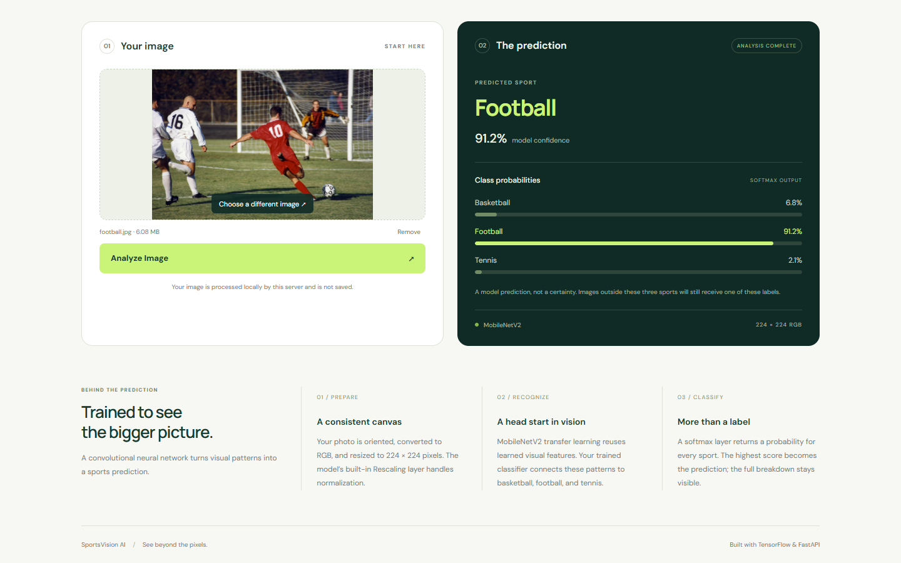

# SportsVision AI

A responsive sports image classifier with a FastAPI backend, a plain HTML/CSS/JavaScript frontend, and your existing TensorFlow/Keras MobileNetV2 model. Predictions are computed by the supplied model; there are no mock results or training steps.

## Project structure

```text
sports-image-classifier/
├── backend/
│   ├── __init__.py
│   └── main.py          # Startup model loading, image validation, inference, routes
├── frontend/
│   ├── index.html       # Homepage, upload, results, model explanation
│   ├── styles.css       # Responsive layout and styling
│   └── app.js           # Drag/drop, preview, API requests, probability bars
├── models/
│   ├── sports_model.keras  # Unmodified copy of your trained model
│   └── labels.json         # Unmodified ordered class names
├── .gitignore
├── requirements.txt
└── README.md
```

## Windows installation

Dependencies have not been installed and the server has not been started as part of project creation. When you are ready, use **64-bit Python 3.11** and open PowerShell:

```powershell
cd "C:\Users\amine\OneDrive\Desktop\sports-image-classifier"
py -3.11 -m venv .venv
.\.venv\Scripts\python.exe -m pip install --upgrade pip
.\.venv\Scripts\python.exe -m pip install -r requirements.txt
```

Calling the virtual environment's Python directly avoids PowerShell activation policy issues. TensorFlow is a large dependency; installation can take several minutes. The dependency ranges allow compatible updates and are not a tested lockfile. The supplied artifact records Keras 3.13.2, so an older Keras is intentionally excluded.

## Start the application

Run from the project folder:

```powershell
.\.venv\Scripts\python.exe -m uvicorn backend.main:app --host 127.0.0.1 --port 8000
```

Wait for `Application startup complete`, then open **http://127.0.0.1:8000**. Stop with **Ctrl+C**. The frontend and API share the same server; do not open `index.html` directly. Use a single worker to keep one model instance in memory. Each additional worker or development reload loads its own model.

Upload or drop one JPEG, PNG, or WebP still image, check its preview, and select **Analyze Image**. You will see the highest-scoring sport and all three class probabilities. The interface starts with an empty state, never fabricated scores.

## Model and preprocessing

- `models/sports_model.keras` is loaded once at startup using `tf.keras.models.load_model(..., compile=False)`. No weights are changed and no replacement model is downloaded.
- Labels are read in their original order from `models/labels.json`: `basketball`, `football`, `tennis`. API labels remain unchanged; the UI capitalizes them for display.
- Uploaded images are EXIF-oriented, converted to RGB, resized with bilinear interpolation to **224 × 224**, and converted to a float32 batch shaped `(1, 224, 224, 3)`.
- Pixel values stay in **0–255**. Do **not** divide by 255 or call MobileNetV2 `preprocess_input`: the saved model already contains a Rescaling layer with scale `1/127.5` and offset `-1`.
- The supplied model has a MobileNetV2 backbone, global average pooling, and a three-unit softmax output. Its probabilities are returned directly, without applying softmax a second time.
- Confidence is the highest softmax probability, not a validated accuracy measure. The model always selects one of its three known sports, including for unrelated images. Training accuracy and calibration were not supplied.

## API

- `GET /` — frontend.
- `GET /api/health` — readiness and ordered class names (available after startup).
- `POST /api/predict` — multipart form upload with field name `file`.
- `GET /docs` — interactive FastAPI API documentation.

Response fields:

```text
predicted_sport: string from labels.json
confidence: number between 0 and 1
probabilities: ordered array of { sport: string, probability: number }
```

Example request in a second PowerShell window after startup:

```powershell
curl.exe -X POST "http://127.0.0.1:8000/api/predict" -F "file=@C:\path\to\sports-photo.jpg"
```

The backend checks MIME type and actual decoded format, rejects empty, corrupt, animated, oversized (over 10 MiB), and excessively large images (over 25 megapixels), and validates the model's probability output. Missing file fields receive FastAPI's 422 validation response. Other errors use an HTTP error status and a JSON `detail` message. Inference failures are logged server-side without exposing their traceback to the frontend. A missing/incompatible model or invalid labels fails startup visibly instead of serving fake predictions.

Image decoding and inference run in a worker thread; model calls are serialized. Uploads are not retained by application code, though the multipart parser may temporarily spool uploads to disk and closes them after processing. This is a local application. Before exposing it publicly, add reverse-proxy request-size limits, authentication as appropriate, rate limits, and concurrency controls; the application file-size check runs after multipart parsing.

The UI optionally loads DM Sans and Manrope from Google Fonts; system sans-serif fallbacks work offline. No image is sent to an external inference service.

## Verification and troubleshooting

Initial project creation included syntax and artifact metadata checks. Subsequently, the running application was verified with real browser uploads and model predictions for football, basketball, and tennis. Desktop and mobile screenshots are available in `report_screenshots/`, along with capture notes, image credits, and the actual API responses. These three examples are a functional check, not a measurement of overall model accuracy.

After starting the server, check `/api/health`, try a known photo for each sport, confirm that the displayed probabilities sum to approximately 100% (rounding may vary), and test invalid and oversized files. Resize the browser to check the stacked mobile layout.

If startup fails, confirm that both model files exist under `models/` and that you installed dependencies with the same virtual-environment Python used for startup. Read the terminal traceback for the precise model compatibility issue. If port 8000 is busy, change `--port 8000` to `--port 8001` and open that port instead.

The supplied `.keras` model is included in this repository unchanged, along with `models/labels.json`. No retraining or separate model download is required. The original files in Downloads are unchanged.

## Report screenshots

The original report screenshots document the single-image version; they have not been replaced by the new organization feature's test captures.

Download `sportsvision_screenshots.zip` or browse `report_screenshots/`. The archive contains all eight requested views plus full-viewport alternatives, photograph credits, and actual prediction responses. Read `report_screenshots/CAPTURE_NOTES.md` before reusing the photographs in your report.



The source photographs and reproducible Playwright capture script are in `report_assets/`. Browser capture requires an additional optional dependency (`python -m pip install playwright`) and Microsoft Edge; it is not needed to run the web application.

## Automatic Sports Image Organization

Below the original single-image classifier, select or drop a collection and click **Organize Images**. The three galleries show the original photo thumbnails, predicted sport, confidence, and category counts. Failed files are listed separately and do not stop the other images. Selecting another collection clears previous results; **Clear collection** releases its local preview URLs.

Limits: **20 files**, **10 MiB per file**, **50 MiB combined**, and **25 million pixels per image**. JPEG, PNG, and WebP still images are accepted. File type, actual decoded format, dimensions, empty/corrupt data, and animation checks use the same classification function as single-image analysis. Unsupported or oversized individual files become per-file errors. Too many files or excessive total size rejects the whole request. Batch requests also have a 51 MiB request-body cap (including multipart overhead), enforced before parsing even for chunked uploads.

**Download Organized ZIP** uploads the same selected originals again, revalidates and reclassifies them with the already-loaded model, and builds a ZIP entirely in memory. There are no stored batches, retention tokens, or client-supplied classification labels. Multipart parsing may use temporary upload files, which are closed after every request. No uploaded image is permanently saved. The browser retains its selected files only for the current page session.

The ZIP contains these folders, including empty categories:

```text
basketball/
football/
tennis/
```

Each successful file keeps its original bytes. Filenames have a unique input index, a sanitized original stem, and the actual image format's extension (for example, `football/002_match.jpg`). This prevents duplicates from overwriting one another and removes path traversal characters. Failed images are excluded. If every file fails, the gallery displays the errors and ZIP download is disabled; direct ZIP requests return HTTP 422.

### Batch API

- `POST /api/organize`: multipart uploads with repeated `files` fields. Returns `results` in input order, `counts`, `total`, `succeeded`, and `failed`. Every result has `index`, `filename`, and `status`; successes include the normal prediction fields and `archive_path`, while failures include `error`.
- `POST /api/organize/zip`: same upload fields, returning `application/zip` with attachment filename `sportsvision_organized.zip`. `X-Organized-Count` and `X-Failed-Count` report processing outcomes. No uploaded data is cached.

```powershell
curl.exe -X POST "http://127.0.0.1:8000/api/organize" -F "files=@C:\photos\match.jpg" -F "files=@C:\photos\court.png"
curl.exe -X POST "http://127.0.0.1:8000/api/organize/zip" -F "files=@C:\photos\match.jpg" -o organized.zip
```

### Run the integration tests

Tests call the real model using the photographs in `report_assets/`. No mock inference is used. Start an instance on port 8001:

```powershell
.\.venv\Scripts\python.exe -m uvicorn backend.main:app --host 127.0.0.1 --port 8001
```

In another terminal in the project folder:

```powershell
.\.venv\Scripts\python.exe -m unittest discover -s tests -v
.\.venv\Scripts\python.exe tests/browser_organization.py
```

Backend tests use the existing dependencies and Python standard library. Browser tests require the optional Playwright package and Microsoft Edge. Backend tests cover single/batch agreement, all input formats, grouping, original ZIP bytes, safe filenames, duplicates, corrupted/empty/animated/oversized images, dimensions, batch limits, and all-invalid requests. Browser tests cover the original classifier, batch galleries and counts, partial failures, actual downloads, mobile overflow, clearing results, and disabling downloads when all files fail. Browser screenshots and the downloaded test ZIP go to ignored `test_artifacts/`.

## Training notebook and academic evidence

- [Original Google Colab notebook](https://colab.research.google.com/drive/1zgeVvl2XZNKWtXm44oMiwRtb2vpyfGwb?usp=sharing) (includes real execution outputs).
- [Source notebook stored in this repository](notebooks/SportsVision_AI_Training.ipynb) (all 19 original source cells; bulky execution outputs removed).
- [Dataset split audit](scripts/check_dataset.py): inspects the upstream Kaggle `train/`, `valid/`, `test/` folders. The source dataset is already split; the script does not resplit it.
- [Final academic report](rapport/rapport_sportsvision.pdf) (model architecture, measured learning curves from original Colab outputs, Precision/Recall/F1-score, confusion matrix, ethics, implementation and screenshot evidence).

The 15-image test sample has 5 examples per class. The observed accuracy, precision, recall and F1-score are all 1.00 **on this tiny test set only**; the results should not be treated as a general guarantee.
